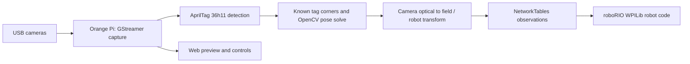

# Umbra

**Umbra** is FRC Team 9015's C++20 AprilTag vision application for an Orange Pi 5 Ultra. USB cameras observe field tags; Umbra estimates the robot's field pose and sends observations to a roboRIO over WPILib NetworkTables. The project is under active development. A successful build or a running service does not establish that a pose is safe for robot odometry.

## Contents

- [What Umbra does](#what-umbra-does)
- [Implemented features](#implemented-features)
- [How it works](#how-it-works)
- [Requirements](#requirements)
- [First-time setup](#first-time-setup)
- [Build and test](#build-and-test)
- [Changed the code? Build and deploy your changes](#changed-the-code-build-and-deploy-your-changes)
- [Configuration and robot integration](#configuration-and-robot-integration)
- [Operating Umbra](#operating-umbra)
- [Having issues?](#having-issues)
- [Documentation](#documentation)

## What Umbra does

A roboRIO estimates motion from its sensors, but wheel slip and other errors can accumulate. AprilTags at known field positions provide independent visual reference points. Umbra captures camera images, detects known tags, matches their image corners to 3D field coordinates, estimates the camera's pose, applies the measured camera mount transform, and publishes the resulting robot position and heading. Robot code can use fresh, validated observations in its own pose estimator; Umbra does not implement the roboRIO fusion code.

Umbra was developed for Team 9015's robot and has seen physical robot testing. The checked-in application still has robot-specific runtime paths and a known failing distance test. New teams must calibrate their cameras, measure their mounts, install matching target libraries, and validate on their own robot before relying on poses.

## Implemented features

| Capability | Current implementation |
| --- | --- |
| Multiple cameras | One worker per camera in `config.json`; each publishes its own topic. |
| Detection and pose | AprilTag `tag36h11` detection; at least two accepted, mapped tags; OpenCV SQPnP followed by LM refinement. |
| Calibration and mounts | Per-camera intrinsics, distortion, and six-degree mount transform. |
| Robot communication | NT4 client using `team_number`; `/Umbra/<camera-name>/observations` double array. |
| Browser interface | MJPEG preview and exposure, gain, brightness controls at port 5801; Save writes `config.json`. |
| Diagnostics | `UMBRA_DIAGNOSTICS=1` enables periodic per-camera timing and status logs. |
| Tests and builds | Native CTest pose-math suite and Debian Trixie/Podman ARM64 cross-build. |
| Startup | The team's Pi uses `umbra.service`; its installed unit is not in this repository. An example is in [Operations](docs/OPERATIONS.md#example-systemd-unit). |

The capture pipeline **requests** MJPEG 1280×800 at 100 fps. That is a pipeline setting, not a measured throughput guarantee.

## How it works



`main.cpp` owns capture, detection, NetworkTables, and the web server. `pose_math.cpp` contains the geometry shared by production and the native tests. For each frame, only detections with IDs in `field.json` and decision margin above 50 contribute corners. Umbra publishes only after a successful multi-tag solve and if processing has not exceeded the 500 ms frame-age limit. No new array is published otherwise; a subscriber must check **freshness** because the last NetworkTables value can remain visible. See [Configuration](docs/CONFIGURATION.md#networktables-observation-format) for the exact nine values and coordinate units.

## Requirements

| Component | Confirmed by repository | What a new team must provide |
| --- | --- | --- |
| Target | Orange Pi 5 Ultra running ARM64 DietPi/Debian 13 Trixie in the working setup | Matching board image, power, storage, network |
| Cameras | V4L2 cameras capable of the hard-coded MJPEG pipeline | Compatible USB cameras; individual calibration and mount measurements |
| Host | Arch Linux x86-64, Fish shell in the working setup | Git, CMake, Ninja, C++ compiler, Podman, rsync, SSH |
| Target libraries | OpenCV 4.10, AprilTag 3, nlohmann_json, WPILib `ntcore`/`wpiutil`/`wpinet` | ARM64 headers and shared libraries matching the Pi; GStreamer and `v4l2-ctl` |
| Build | `Containerfile.cross` uses Debian Trixie and AArch64 GCC | A sysroot copied from the target into a sibling `umbra-sysroot` directory |
| Robot | NT4 client calls `SetServerTeam(team_number)` | A reachable roboRIO and robot code that validates and fuses observations |

[Pi setup](docs/PI_SETUP.md) and [Cross-compiling](docs/CROSS_COMPILING.md) give the detailed prerequisites. **Fresh installation is not yet fully reproducible from this repository:** the exact procedure and versions used to install WPILib ARM64 libraries on the existing Pi were not recorded. Resolve that prerequisite before expecting a clean cross-build or run.

## First-time setup

1. On an Arch host, clone the project in `~/Documents/QE/Umbra` so the checked-in container commands can mount its parent as `/work`:

   ```fish
   mkdir -p ~/Documents/QE
   git clone https://github.com/FRC9015/Umbra ~/Documents/QE/Umbra
   cd ~/Documents/QE/Umbra
   ```
2. [Image and prepare the Orange Pi](docs/PI_SETUP.md), including network, camera access, GStreamer, and required target libraries.
3. [Install host tools, build `umbra-cross`, and copy a compatible Pi sysroot](docs/CROSS_COMPILING.md#first-time-host-setup).
4. [Run the native tests](docs/TESTING.md#run-the-suite) and [build the ARM64 executable](docs/CROSS_COMPILING.md#configure-and-build).
5. [Install the executable without replacing a known-good binary](docs/DEVELOPMENT.md#first-deployment-to-a-new-pi).
6. [Set robot-specific cameras, calibration, mounts, and field data](docs/CONFIGURATION.md); [start and inspect the service](docs/OPERATIONS.md#service-control).
7. [Verify both cameras and fresh robot observations](docs/OPERATIONS.md#verify-localization).

An already configured Team 9015 host/Pi can use the shorter workflow below. Other teams should work through the guides because the scripts and runtime paths contain team-specific values.

## Build and test

From the **Arch host, Fish shell**, with dependencies installed:

```fish
cd ~/Documents/QE/Umbra
bash scripts/test-local.sh
ctest --test-dir build/native-tests -N
```

`test-local.sh` configures and builds `umbra_pose_tests` in `build/native-tests` and runs CTest. It intentionally disables the camera/NetworkTables app for the native host build. The current registration has **43 tests**. The last recorded local result was **42 passed, 1 failed** (`range.tag_distance`); this documentation change did not rerun them. See [Testing](docs/TESTING.md#known-baseline-failure).

Build the cross-compile container once:

```fish
podman build -t umbra-cross -f Containerfile.cross .
```

With the Pi-derived sysroot at `~/Documents/QE/umbra-sysroot`, configure and build the application:

```fish
podman run --rm -v "$PWD/..:/work" -w /work/Umbra umbra-cross \
    cmake -S . -B build/arm64 -G Ninja \
    -DCMAKE_TOOLCHAIN_FILE=/work/Umbra/cmake/aarch64-dietpi.cmake \
    -DCMAKE_BUILD_TYPE=Release \
    -DOpenCV_DIR=/work/umbra-sysroot/usr/lib/aarch64-linux-gnu/cmake/opencv4 \
    -Dnlohmann_json_DIR=/work/umbra-sysroot/usr/share/cmake/nlohmann_json
podman run --rm -v "$PWD/..:/work" -w /work/Umbra umbra-cross \
    cmake --build build/arm64 --parallel 4
file build/arm64/Umbra
```

The output is `build/arm64/Umbra`, an ARM64 ELF on the existing build. These commands match [the checked-in deployment script](scripts/deploy-test.sh); they require a compatible sysroot and target libraries. They do not deploy.

## Changed the code? Build and deploy your changes

On an **already configured host**, run the tests, then rebuild and inspect the target binary:

```fish
cd ~/Documents/QE/Umbra
bash scripts/test-local.sh
podman run --rm -v "$PWD/..:/work" -w /work/Umbra umbra-cross \
    cmake --build build/arm64 --parallel 4
file build/arm64/Umbra
sha256sum build/arm64/Umbra
```

If the ARM64 build directory has not been configured, use [the configuration command above](#build-and-test) first. Investigate the known `range.tag_distance` failure separately; require all previously passing cases to remain passing. On the Pi, **identify the running executable and back up the known-good file before replacing anything**. `scripts/deploy-test.sh` is a team-specific test-binary transfer to `/home/dietpi/Umbra/Umbra-test`; it does not update `umbra.service`.

For a production update, first inspect `systemctl cat umbra.service` and verify that the running, robot-tested executable is actually `/home/dietpi/Umbra/build/Umbra`. If it is not, use [the detailed procedure](docs/DEVELOPMENT.md#subsequent-update) with the verified path. For that confirmed layout, on the **Pi (Bash)**:

```bash
sha256sum /home/dietpi/Umbra/build/Umbra
cp -a /home/dietpi/Umbra/build/Umbra /home/dietpi/Umbra/build/Umbra.backup &&
  cmp -s /home/dietpi/Umbra/build/Umbra /home/dietpi/Umbra/build/Umbra.backup &&
  sudo systemctl stop umbra.service
```

Then on the **Arch host (Fish)**, replace the example IP and stage the new file:

```fish
set PI dietpi@192.0.2.10
rsync -av build/arm64/Umbra "$PI:/home/dietpi/Umbra/build/Umbra.candidate"
sha256sum build/arm64/Umbra
ssh $PI 'sha256sum /home/dietpi/Umbra/build/Umbra.candidate'
```

**Compare the full hashes before proceeding.** On the **Pi (Bash)**:

```bash
chmod 755 /home/dietpi/Umbra/build/Umbra.candidate
mv /home/dietpi/Umbra/build/Umbra.candidate /home/dietpi/Umbra/build/Umbra
sudo systemctl start umbra.service
sudo systemctl status umbra.service --no-pager
sudo journalctl -u umbra.service -n 100 --no-pager
```

Check both cameras and fresh robot observations; [Development](docs/DEVELOPMENT.md#subsequent-update) covers library checks, verification, and rollback. Keep `config.json` and `field.json` on the Pi intact. A cross-build alone cannot validate real camera timing, mounting, or robot behavior.

## Configuration and robot integration

The application reads **absolute paths** `/home/dietpi/Umbra/config.json` and `/home/dietpi/Umbra/field.json`. Set `team_number` to your FRC team, replace camera paths with stable V4L2 identifiers, calibrate each camera at the actual capture mode, and measure each camera's robot-relative pose. The current tag size constant is 0.1651 m; verify it against your field tags. See [Configuration](docs/CONFIGURATION.md) for schema, units, active versus ignored tuning fields, and the NetworkTables contract.

Robot code must check observation length, finite values, camera identity, timestamp freshness, tag count, and plausibility before passing vision poses to WPILib. Umbra publishes a nine-value array, **not** a WPILib pose object or uncertainty model; the robot owns the fusion policy.

## Operating Umbra

The team uses `umbra.service` for startup, but the installed production unit is not versioned here. [Operations](docs/OPERATIONS.md) shows how to inspect it, run manually, check logs, enable diagnostics, and use the web interface. A service marked “active” proves a process is running, not that tags are being detected or valid observations are reaching the roboRIO.

## Having issues?

| Symptom | Start here |
| --- | --- |
| Pi will not boot, connect, or accept SSH | [Installation](docs/TROUBLESHOOTING.md#installation) |
| Podman, CMake, sysroot, dependency, or architecture error | [Cross-compilation](docs/TROUBLESHOOTING.md#cross-compilation) |
| Native build or CTest failure | [Testing](docs/TROUBLESHOOTING.md#testing) |
| Transfer, hash, permission, shared-library, or executable-path problem | [Deployment](docs/TROUBLESHOOTING.md#deployment) |
| Camera missing, no poses, wrong pose, stale NT data, or failed service | [Runtime](docs/TROUBLESHOOTING.md#runtime) |
| Camera calibration or robot mount setup | [Configuration](docs/CONFIGURATION.md#calibration-and-camera-mounts) |
| Need to install or update the executable | [Development](docs/DEVELOPMENT.md) |

## Documentation

| Guide | Purpose |
| --- | --- |
| [Pi setup](docs/PI_SETUP.md) | Fresh board image, first boot, packages, cameras, and readiness checks |
| [Cross-compiling](docs/CROSS_COMPILING.md) | Host tools, Podman, sysroot, target dependencies, ARM64 builds |
| [Development](docs/DEVELOPMENT.md) | Daily workflow, first deployment, safe updates, rollback |
| [Testing](docs/TESTING.md) | Native suite, cases, expected failure, hardware limits |
| [Configuration](docs/CONFIGURATION.md) | Camera calibration, transforms, field map, NT and web controls |
| [Operations](docs/OPERATIONS.md) | Manual runs, systemd, diagnostics, verification, backups |
| [Troubleshooting](docs/TROUBLESHOOTING.md) | Symptom-led checks and corrections |

The earlier [test baseline](MdFiles/TESTING.md) and [audit roadmap](MdFiles/ROADMAP.md) remain available for detailed project history.

