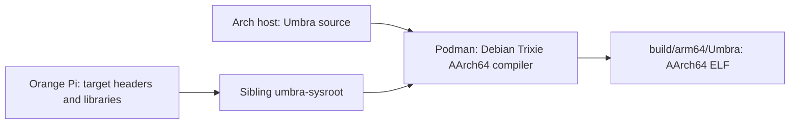

# ARM64 cross-compiling

Umbra is built on an x86-64 Arch host for an AArch64 Orange Pi. An ordinary host executable cannot run on the Pi because machine instructions and linked libraries differ. The checked-in `Containerfile.cross` supplies Debian Trixie CMake, Ninja, and `aarch64-linux-gnu-gcc/g++`. The **Pi-derived sysroot** supplies target headers, CMake package files, and ARM64 libraries. The container does not install OpenCV, AprilTag, or WPILib itself.



## First-time host setup

These are **Arch host (Fish)** commands. The package names match Arch's current [package index](https://archlinux.org/packages/); package versions can change. Arch recommends a complete system update rather than a partial upgrade.

```fish
sudo pacman -Syu --needed git cmake ninja gcc binutils opencv nlohmann-json podman rsync openssh file
mkdir -p ~/Documents/QE
git clone https://github.com/FRC9015/Umbra ~/Documents/QE/Umbra
cd ~/Documents/QE/Umbra
podman build -t umbra-cross -f Containerfile.cross .
```

`podman build` constructs the image used by `scripts/deploy-test.sh`. Native tests use the host's OpenCV and JSON headers; the app cross-build uses the Pi's OpenCV 4.10 and ARM64 libraries. `scripts/test-local.sh` detects Arch's current `/usr/lib/cmake/opencv5`, or accepts `OpenCV_DIR`.

The repository layout matters:

```text
~/Documents/QE/
├── Umbra/           # this checkout
└── umbra-sysroot/   # Pi-derived target files, outside Git
```

The Podman command mounts `~/Documents/QE` at `/work`. The CMake toolchain file fixes `CMAKE_SYSROOT=/work/umbra-sysroot` and directs CMake to find target libraries, headers, and packages there while using programs from the container. It sets try-compiles to static-library mode. A different checkout layout requires changing the mount or toolchain; the current checked-in script assumes this one.

## Prepare the target before copying a sysroot

Follow [Pi setup](PI_SETUP.md) first. The working Pi has OpenCV 4.10, AprilTag, nlohmann_json CMake metadata, and WPILib `ntcore`/`wpiutil`/`wpinet` under `/usr/local/lib`. The exact WPILib ARM64 installation procedure is **not recorded**; copying a Pi without these files will not produce a working sysroot. Verify on the **Pi (Bash)**:

```bash
uname -m
ls -ld /usr/include /usr/lib/aarch64-linux-gnu/cmake/opencv4 \
  /usr/share/cmake/nlohmann_json /usr/local/include /usr/local/lib
ldconfig -p | grep -E 'lib(apriltag|ntcore|wpiutil|wpinet)'
```

The `ls` check may reveal missing directories; it is a diagnostic, not a claim that a fresh image has them. Target OpenCV CMake metadata must match the installed target libraries, and the compiler/container release should remain compatible with the Pi's Debian release.

## Copy the sysroot from the Pi

The following **Arch host (Fish)** commands are adapted from commands found in local Fish history; they were used for the existing environment, but **were not rerun or validated on a clean machine for this documentation**. Replace the example IP. They copy headers, target libraries, local WPILib installations, and shared CMake metadata:

```fish
set PI dietpi@192.0.2.10
set SYSROOT "$HOME/Documents/QE/umbra-sysroot"
mkdir -p "$SYSROOT/usr/include" "$SYSROOT/usr/lib" \
  "$SYSROOT/usr/local/include" "$SYSROOT/usr/local/lib" "$SYSROOT/usr/share/cmake"
rsync -a --info=progress2 "$PI:/usr/include/" "$SYSROOT/usr/include/"
rsync -a --info=progress2 "$PI:/usr/lib/" "$SYSROOT/usr/lib/"
rsync -a --info=progress2 "$PI:/usr/local/include/" "$SYSROOT/usr/local/include/"
rsync -a --info=progress2 "$PI:/usr/local/lib/" "$SYSROOT/usr/local/lib/"
rsync -a --info=progress2 "$PI:/usr/share/cmake/" "$SYSROOT/usr/share/cmake/"
ln -sfn usr/lib "$SYSROOT/lib"
```

`rsync -a` preserves links. Some library symlinks on the working target resolved outside the copied tree; the recorded repair copied the resolved ARM64 BLAS/LAPACK libraries with `-L`:

```fish
rsync -avL "$PI:/usr/lib/aarch64-linux-gnu/libblas.so.3" \
  "$SYSROOT/usr/lib/aarch64-linux-gnu/"
rsync -avL "$PI:/usr/lib/aarch64-linux-gnu/liblapack.so.3" \
  "$SYSROOT/usr/lib/aarch64-linux-gnu/"
```

Use those last commands only if `readlink -e`/linking shows broken BLAS/LAPACK references; the packages and exact links can differ. Other runtime dependencies may need additional target paths. Do not mix host x86-64 libraries into this tree. The sysroot is outside the checkout and should stay out of Git.

Check the **Arch host (Fish)** copy:

```fish
ls "$SYSROOT/usr/lib/aarch64-linux-gnu/cmake/opencv4"
ls "$SYSROOT/usr/share/cmake/nlohmann_json"
ls "$SYSROOT/usr/lib/aarch64-linux-gnu/libapriltag.so"
ls "$SYSROOT/usr/local/lib/libntcore.so" "$SYSROOT/usr/local/lib/libwpiutil.so" "$SYSROOT/usr/local/lib/libwpinet.so"
file "$SYSROOT/usr/local/lib/libntcore.so"
```

A missing path means target setup or sysroot copy is incomplete. Check target library dependencies with `readelf -d`/`ldd` on the Pi; CMake discovery alone is insufficient.

## Configure and build

From `~/Documents/QE/Umbra` on the **Arch host (Fish)**:

```fish
podman run --rm -v "$PWD/..:/work" -w /work/Umbra umbra-cross \
  cmake -S . -B build/arm64 -G Ninja \
  -DCMAKE_TOOLCHAIN_FILE=/work/Umbra/cmake/aarch64-dietpi.cmake \
  -DCMAKE_BUILD_TYPE=Release \
  -DOpenCV_DIR=/work/umbra-sysroot/usr/lib/aarch64-linux-gnu/cmake/opencv4 \
  -Dnlohmann_json_DIR=/work/umbra-sysroot/usr/share/cmake/nlohmann_json
podman run --rm -v "$PWD/..:/work" -w /work/Umbra umbra-cross \
  cmake --build build/arm64 --parallel 4
file build/arm64/Umbra
readelf -h build/arm64/Umbra
readelf -d build/arm64/Umbra
```

The first command runs **inside Podman** and writes CMake/Ninja metadata to `build/arm64`. The second compiles; `file`/`readelf` on the host should report an AArch64 ELF. `readelf -d` lists required shared libraries. The existing target binary is dynamically linked (with `/usr/local/lib` and `/usr/lib/aarch64-linux-gnu` in its run path), so the Pi needs compatible shared libraries at runtime. `umbra_pose` is a static library within the build; that does **not** make the final executable fully static.

`CMakeLists.txt` finds OpenCV always. It finds nlohmann_json for the app or tests, and links `ntcore`, `wpiutil`, `wpinet`, and `apriltag` for the app. The two explicit `*_DIR` options point to package metadata inside the target sysroot. The source also includes `apriltag.h` and NetworkTables headers; these must be in the copied target includes.

## Subsequent builds

After a source edit on the **Arch host (Fish)**:

```fish
cd ~/Documents/QE/Umbra
bash scripts/test-local.sh
podman run --rm -v "$PWD/..:/work" -w /work/Umbra umbra-cross \
  cmake --build build/arm64 --parallel 4
file build/arm64/Umbra
```

Reconfigure if the toolchain, sysroot, dependency locations, or CMake options change. Do not assume native tests exercise camera, web, or NT hardware paths. See [Development](DEVELOPMENT.md) for deployment and rollback.

## Recreating or refreshing the environment

On another computer, install the host packages, clone into the expected sibling layout, build `umbra-cross`, prepare a matching Pi, copy its sysroot, configure, then build. Refresh the sysroot **after Pi library or OS updates**, including WPILib updates; stale headers or libraries can cause link success with runtime ABI failure. Reconfigure the ARM64 build directory after significant dependency changes. If CMake reports missing OpenCV/nlohmann_json or the linker reports undefined references, inspect the actual sysroot files and package metadata first; [Troubleshooting](TROUBLESHOOTING.md#cross-compilation) has specific checks.

The documented copy sequence is historically supported, but the missing WPILib install provenance and possible transitive libraries remain barriers to a guaranteed fresh-machine reproduction.
